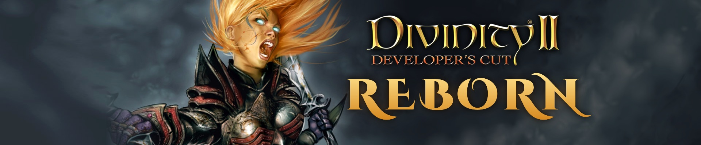
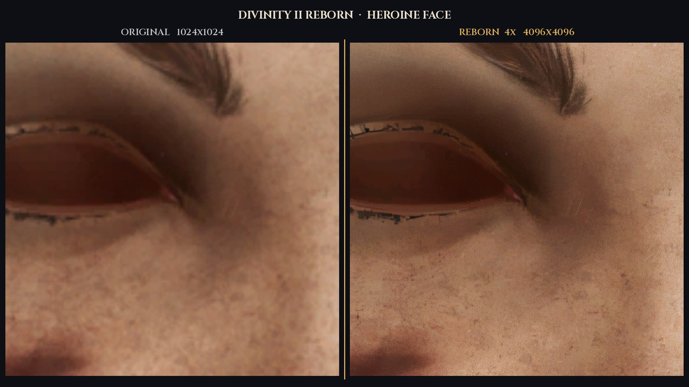
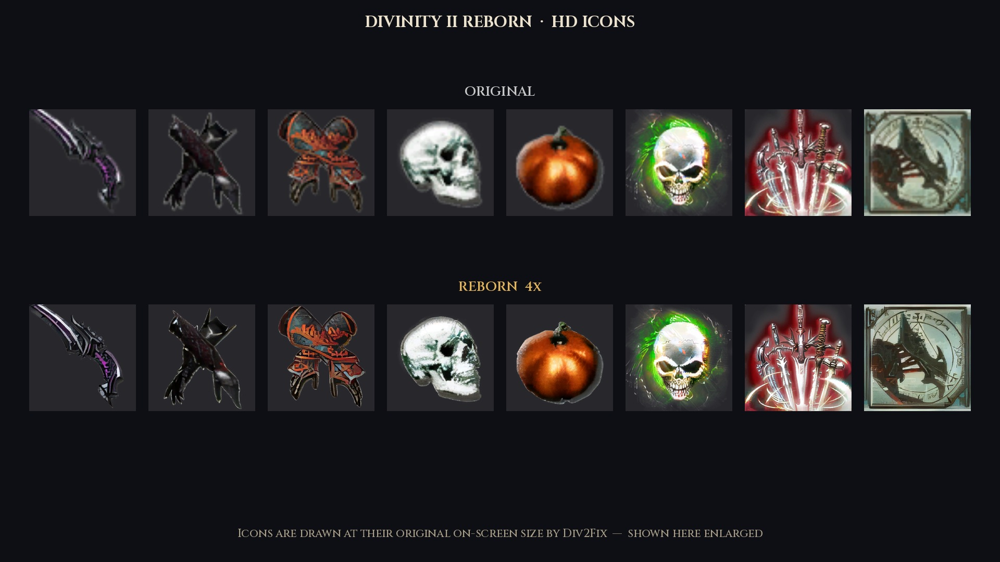

# Divinity II Reborn

A visual, engine and quality-of-life overhaul for **Divinity II: Developer's Cut** (Steam, Windows):
a spoiler-free **mind-reading advisor**, **4x AI-upscaled textures**, HD normal maps and icons, a fix for the
game's **hard, flickering shadow edges**, 8K shadow maps, smoother bloom and sun rays, correct **ultrawide menus**,
intro skip and more. Gameplay, balance and saves are not changed.

**Download, full description and installation:** Nexus Mods — *(link)*

This repository contains the source code of **Div2Fix** (`bin/dinput8.dll`), the engine part of the mod.

## For players

**Requirements:** Divinity II: Developer's Cut (Steam), a Vulkan 1.3 GPU,
and **[Div2Patch](https://github.com/BlanknameES/Div2Patch)** by BlanknameES (install it first).

**Installation:** install Div2Patch → extract `DivinityIIReborn_v1.3.zip` into the game folder (the one with
`bin` and `Data`) → optionally extract the HD texture pack there too → play.
Settings: `bin\Div2Fix.ini`. Uninstall: `_Div2Reborn\uninstall.cmd`.

### Highlights

* **Mind-reading advisor** — the "Mind reading will cost you N experience" popup gets one more line telling you
  whether the read is worth it: *useful* (skill/stat points, items, skills, XP, gold), *something, but not much*
  (discounts, dialogue options, quest info) or *just thoughts*. The verdicts come from the game's own dialogue and
  script data for 337 characters; no names, no plot, no spoilers. 7 languages.
* **Soft shadows** — the game's variance-shadow-map blur throws away the depth variance in its second pass, so shadow
  edges are hard, stair-stepped and flicker on foliage. Div2Fix replaces that pass with a corrected copy.
* **HD textures** (separate pack) — 1,516 colour textures 4x, 1,225 normal maps and 1,508 material layers 2x,
  966 icons and 227 interface images 4x; Div2Fix draws the HD icons at their original on-screen size.
* **Ultrawide menus** at 16:9 with correct mouse hit-testing, key names in hints with non-Latin layouts,
  non-Latin map-marker text, in-game keyboard-layout switching, intro skip, window icon, strafe left+right fix,
  8K shadow maps, 3x draw distance, smoother bloom and sun rays, wider camera zoom.

## How Div2Fix works

Div2Fix is a `dinput8.dll` proxy: the game loads it from its `bin` folder, every DirectInput call is
forwarded to the real `System32\dinput8.dll`, and at start-up Div2Fix applies small in-memory patches
to `Divinity2.exe`. **No file of the game is modified and nothing is written to saves.**
Every patch first compares the original bytes at its location; if they differ (another game build),
that patch is skipped and the reason is written to `bin\Div2Fix.log`.

The DLL is plain C (no C runtime, no third-party code). It imports only `kernel32.dll` and `user32.dll`
(see `src/kernel32.def`, `src/user32.def`) and does not access the network, the registry or any file
outside the game folder (it reads `Div2Fix.ini`, `Div2Fix_mindread.txt`, `..\lang.ini` and writes
`Div2Fix.log`; with `[Diagnostics] Enable=1` it also writes frame-time reports next to the game).

## Modules (`div2fix/src`)

| File | What it does |
|---|---|
| `div2fix.c` | DLL entry, `dinput8` export forwarding, settings, logging; key names in hints with non-Latin keyboard layouts; ultrawide (21:9/32:9) menus shown at 16:9 with correct mouse hit-testing |
| `gfx.c` | object LOD / draw distance multiplier, shadow-map size, shadow distance, cascade split, shadows from all objects |
| `shadow.c` | soft shadows: replaces the game's faulty 2nd variance-shadow-map blur pass with a corrected copy of the same shader; larger bloom and light-shaft render targets |
| `mindread.c` | mind-reading advisor: adds a spoiler-free verdict line to the mind-read confirmation popup (data: `Div2Fix_mindread.txt`) |
| `icons.c` | draws HD (4x) interface icons at their original on-screen size |
| `uitext.c` | fixes non-Latin (ANSI / widened UTF-8) text shown as boxes, e.g. map-marker labels |
| `intro.c` | skips the start-up logo video |
| `camera.c` | wider mouse-wheel zoom range, zoom step and dragon-form distance (values of Div2Patch, changed in memory) |
| `window.c` | window icon; keyboard-layout switching in game; strafe left+right cancel |
| `version.c` | warns once at start-up if the game build is not the one the mod targets |
| `diag.c` | optional diagnostics: frame-time recorder (F11), D3D9 device hooks used by `shadow.c` |
| `detour.c` | minimal x86 function detour used for D3D9 device methods |

## Build

* **Linux**: LLVM 18 (`clang-cl-18`, `lld-link`, `llvm-dlltool`, `llvm-rc-18`) → `sh div2fix/build.sh`
* **Windows**: LLVM for Windows on `PATH` → `div2fix\build.cmd`

Output: `div2fix/build/dinput8.dll`. See `CHECKSUMS.txt` for the hashes of the released files.

## Third-party files in the release

* `bin/d3d9.dll` — DXVK 3.1.1 (zlib license), unmodified `x32/d3d9.dll` from the official release.
* `res/div2.ico` — the game's own icon (© Larian Studios), used as the window icon.

## Credits

* **Larian Studios** — Divinity II and all original assets.
* **[Div2Patch](https://github.com/BlanknameES/Div2Patch)** by BlanknameES — required, not included.
* **[DXVK](https://github.com/doitsujin/dxvk)** by Philip Rebohle and contributors — shipped unmodified.
* **4x-UltraSharp** by Kim2091 (CC BY-NC-SA 4.0), run with Real-ESRGAN-ncnn-vulkan — used to upscale the textures.

## License

MIT (see `LICENSE`). Divinity II and all its assets are © Larian Studios; this is a non-commercial fan project.
